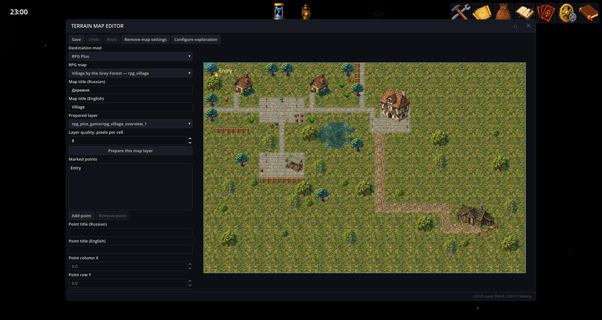
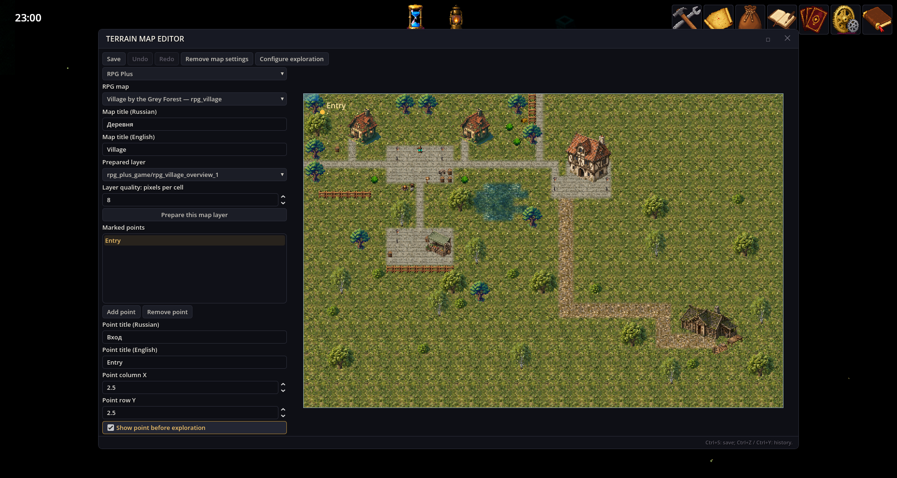

# Terrain map editor

Add **map2d_editor** to the game's authoring tools and open Terrain map editor. Players only need **map2d_base**; saving adds its runtime dependency to the destination content mod.

## Prepare the map

1. Choose a destination mod and an RPG map. The map may belong to a dependency.
2. Enter Russian and English map titles. Empty titles fall back to the normal location name.
3. Prepare this map layer. Eight pixels per cell is the default; the quality control changes its resolution. Preparation uses the normal top-down view and authored base scenery.
4. You may choose an existing PNG instead. Its aspect ratio must match the complete cell rectangle. Regenerate after changing map dimensions.

Generation uses an isolated viewport and reserves a fresh image name. Actors are omitted. Game flags, character positions and source artwork stay unchanged. The result remains window-owned until Save; closing during preparation cancels it.

## Points and exploration

Add a point, enter both titles and select its row. Click the prepared map to move it, or enter its column X and row Y. Coordinates may be fractional. One placement is one undo step; removing a point preserves its neighbours.

Ordinary points appear after their cell is explored. Show point before exploration explicitly permits its icon above unknown terrain, without revealing that terrain.

Configure exploration opens the fog editor for the same map and destination. Choose sight settings and blockers, paint Initially explored cells, then save that profile. Return and save the map. Blue preview cells show that initial knowledge.

Initial exploration applies only when the map's exploration record is first created. Test changed initial knowledge in a new game if that record exists. Resized maps also need a new save with matching exploration dimensions.

## Save and play

Save or Ctrl+S publishes recipes, generated layers and dependencies. Own settings go to maps/terrain_maps.json; inherited edits become narrow patches in the destination mod. Unknown map and point fields survive.

Prepared images go under terrain_maps/<mod>/. Existing files are never overwritten. Generated variants are published on Save so later undo can still restore a previous layer. Removing map settings does not delete their images.

The Terrain map gameplay button shows explored geography, the player and heading, and permitted points. It works with either world projection; the plan keeps the same orientation. Escape or Close restores control. Opening it never explores new terrain.

Save checks point bounds, image and map dimensions, the exploration profile and dependencies. Fix an invalid form before saving; input is never silently normalized. Preview uses a detached model without changing the running game's exploration.
