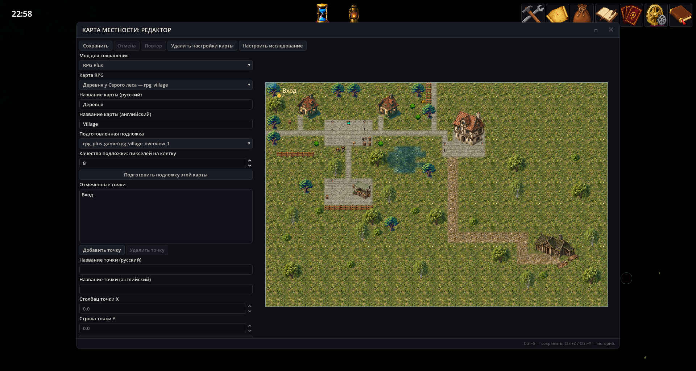
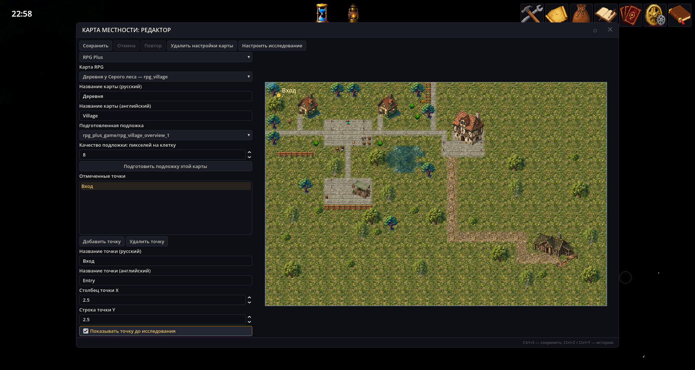

# Редактор карты местности

Добавьте **map2d_editor** в инструменты игры и откройте «Карта местности: редактор». Игроку редактор не нужен: сохранение добавляет зависимость **map2d_base** в мод с картой.

## Подготовить карту

1. Выберите мод, куда сохранять настройки, и карту RPG. Имя карты и мод назначения независимы: можно дополнить карту из зависимости.
2. Введите названия карты на русском и английском. При пустом названии игровая панель использует обычное имя локации.
3. Нажмите «Подготовить подложку этой карты». По умолчанию карта получает восемь пикселей на клетку; поле качества меняет размер изображения. Подготовка использует обычный вид сверху и базовое окружение карты.
4. Вместо подготовки можно выбрать готовую PNG-подложку. Она должна покрывать полный прямоугольник клеток с теми же пропорциями. После изменения размеров карты подготовьте подложку заново.

Генерация работает в отдельном viewport и сохраняет новые изображения под новым именем. NPC не попадают на подложку. Игровые флаги, положение персонажей и исходные картинки остаются прежними. Результат хранится в окне до «Сохранить»; закрытие во время подготовки отменяет её.

## Задать точки и исследование

Нажмите «Добавить точку», введите два названия и выберите строку в списке. Перенесите точку щелчком по подложке или задайте столбец X и строку Y. Координаты могут быть дробными. Один перенос — один шаг отмены. «Удалить точку» сохраняет остальные точки.

Обычная точка появится у игрока после исследования своей клетки. «Показывать точку до исследования» разрешает показывать её сразу над закрытой местностью. Эта настройка относится только к значку, без открытия географии.

Нажмите «Настроить исследование». Откроется отдельный редактор тумана с той же картой и модом назначения. Задайте радиус, преграды и кистью «Открыто с начала игры» известные игроку клетки, затем сохраните профиль. Возвращайтесь в редактор карты и сохраните карту. Синие клетки предпросмотра показывают начальное открытие.

Начальное открытие применяется при первом создании записи исследования карты. Для проверки изменённого начального знания начните новую игру, если запись этой карты уже существует. Изменение размеров карты также требует нового сохранения с подходящими размерами исследования.

## Сохранить и играть

Ctrl+S и кнопка «Сохранить» публикуют настройки, подготовленные изображения и зависимости. Собственные настройки находятся в `maps/terrain_maps.json`; чужие изменения становятся узким патчем в выбранном моде. Неизвестные поля карты и точек сохраняются.

Картинки записываются в `terrain_maps/<мод>/`. Уже существующие файлы не перезаписываются. Созданные при подготовке варианты публикуются при сохранении, чтобы отмена после сохранения могла вернуть предыдущую подложку. Удаление настроек карты не удаляет её изображения.

В игре нажмите кнопку «Карта местности». Панель показывает подготовленную географию в исследованных клетках, игрока, направление и разрешённые точки. Она работает при виде сверху и в изометрии; сам план ориентирован одинаково. Esc или «Закрыть» возвращает управление. Открытие панели не исследует новые клетки.

Сохранение проверяет границы точек, подложку, размеры карты, профиль исследования и зависимости. При ошибке исправьте форму; исходные данные не нормализуются молча. Предпросмотр читает отдельную модель и не меняет память текущей игры.
